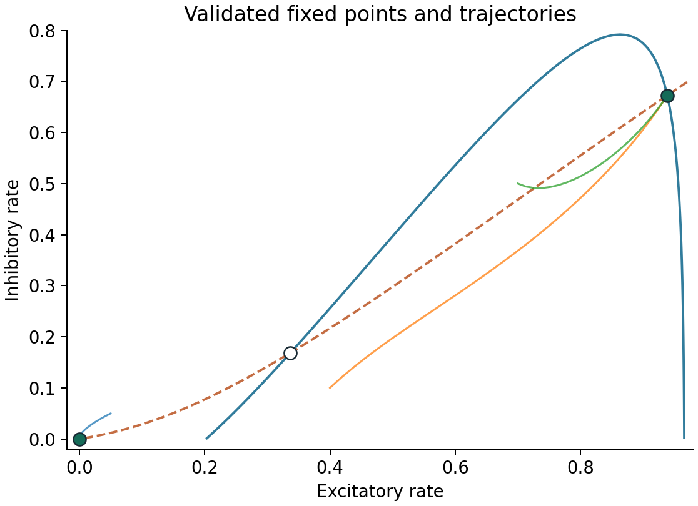

# Wilson–Cowan dynamics

A numerical study of coupled excitatory and inhibitory neural populations: fixed points, stability, stochastic inputs and persistent responses to temporary stimuli.

[Coursework notebook](notebooks/coursework.ipynb) · [Original report](report/coursework-report.pdf) · [Numerical review](reviewed_model.py) · [Method notes](METHODS.md)

## Input-gated memory


For the default coupling parameters `(wEE, wEI, wIE, wII) = (9, 4, 13, 11)`, a temporary excitatory pulse can move the system from the low-activity state to the high-activity state. The response then persists after the input is removed.

A separate November 2026 reproduction tests 51 pulse amplitudes between 0 and 0.50. The first sampled amplitude producing a persistent high response is **0.46**. The pulse lasts from 1,000 to 3,000 ms; persistence is defined as mean excitatory rate above 0.5 during the final 800 ms of a 5,500 ms simulation. This is a grid-based threshold for that protocol, not an analytically derived bifurcation point. Halving the integration step preserves the classification at amplitudes 0.45, 0.46 and 0.47.

## Fixed points and stability



The reviewed multistart root search finds **three fixed points, two locally stable**, for the default parameter set. Filled markers indicate stable equilibria; the open marker indicates the unstable equilibrium. The blue and dashed orange curves are the excitatory and inhibitory nullclines. Each accepted root passes convergence, bounds and residual checks. Stability is determined by the Jacobian eigenvalues.

The original notebook extends the base tutorial with a 22 × 22 coupling scan, additive and Ornstein–Uhlenbeck noise experiments, and the input-pulse study. [METHODS.md](METHODS.md) separates those recorded experiments from the later numerical checks and explains the transfer-function conventions.

## Reproduce the review

```bash
git clone https://github.com/pdmdp/wilson-cowan-dynamics.git
cd wilson-cowan-dynamics
python -m pip install -r requirements.txt
python reproduce.py
```

No external dataset is needed. The script checks root residuals, the analytic Jacobian against finite differences, zero-noise equivalence, seeded simulations and the memory result at a smaller time step. It then regenerates both figures and [results/review.json](results/review.json). Verified with Python 3.14.4 and the numerical versions in `requirements.txt`.

The coursework notebook can be opened with Jupyter. Its saved figures and original code are retained; a short archive note was added. The full original parameter scan and noise sweep were not rerun as part of this review.

## Author and foundations

**Matteo Pietro Di Pilato** · Brain Modelling, BSc in Artificial Intelligence.

The base equations and tutorial helpers follow [Neuromatch Academy's Wilson–Cowan tutorials](https://compneuro.neuromatch.io/tutorials/W2D5_DynamicalSystems/student/W2D5_Tutorial2.html). The course project adds the parameter scan, noise comparisons and pulse experiments. Attribution and the upstream code license are retained in [THIRD_PARTY_NOTICES.md](THIRD_PARTY_NOTICES.md).
