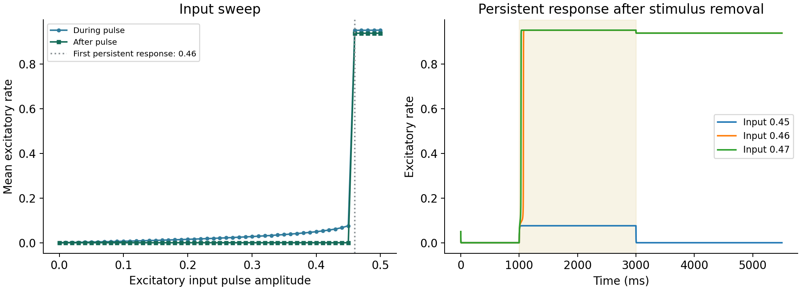

# Wilson–Cowan dynamics

How can a temporary input leave a neural population active after the input has stopped? This project studies that question with two coupled populations: one excitatory and one inhibitory.

For the tested coupling parameters, the model has **two locally stable states**. A sufficiently strong excitatory pulse moves it from low to high activity, where it can remain after the pulse ends. The numerical study combines fixed-point analysis, parameter sweeps and simulations with noisy inputs.

[Notebook](notebooks/coursework.ipynb) · [Report](report/coursework-report.pdf) · [Numerical implementation](reviewed_model.py) · [Methods](METHODS.md)

## From equations to behaviour

The Wilson–Cowan equations describe how excitation and inhibition influence each other's activity. Nullclines locate candidate equilibria; a multistart root search checks the solutions, and Jacobian eigenvalues determine local stability. Simulations then show how trajectories respond to a pulse or to stochastic inputs.

The course study includes a 22 × 22 coupling scan, additive and Ornstein–Uhlenbeck noise experiments, and an input-pulse study. The numerical review checks root residuals, the Jacobian and sensitivity to the integration step.

## Results


With `(wEE, wEI, wIE, wII) = (9, 4, 13, 11)`, the reviewed root search finds **three fixed points, two locally stable**. Filled markers show stable equilibria; the open marker shows the unstable one. The two stable states allow the same constant parameters to support different persistent responses, depending on the trajectory.



Among 51 pulse amplitudes from 0 to 0.50, the first producing a persistent high response is **0.46**. The pulse lasts from 1,000 to 3,000 ms; persistence means a mean excitatory rate above 0.5 in the final 800 ms of a 5,500 ms simulation. Halving the integration step preserves the classification at 0.45, 0.46 and 0.47.

## Contribution

**Matteo Pietro Di Pilato** · Brain Modelling, BSc in Artificial Intelligence. The project extends [Neuromatch Academy's tutorials](https://compneuro.neuromatch.io/tutorials/W2D5_DynamicalSystems/student/W2D5_Tutorial2.html) with coupling scans, noise comparisons and pulse experiments. The [upstream attribution and code license](THIRD_PARTY_NOTICES.md) are retained.

## Limits and next steps

The value 0.46 is the first successful point on this amplitude grid, under one pulse protocol. It is not an analytically established bifurcation threshold or evidence of biological memory. A next step is to map persistence jointly over pulse amplitude and duration, and test how noise changes the transition.

The figures above come from the numerical review. [METHODS.md](METHODS.md) distinguishes it from the original parameter and noise sweeps, which were not all repeated.

## Run

```bash
git clone https://github.com/pdmdp/wilson-cowan-dynamics.git
cd wilson-cowan-dynamics
python -m pip install -r requirements.txt
python reproduce.py
```

No external dataset is needed. The script checks numerical consistency and regenerates both figures and [the result record](results/review.json). Open the coursework notebook with Jupyter to explore the original experiments.
